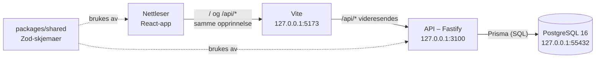
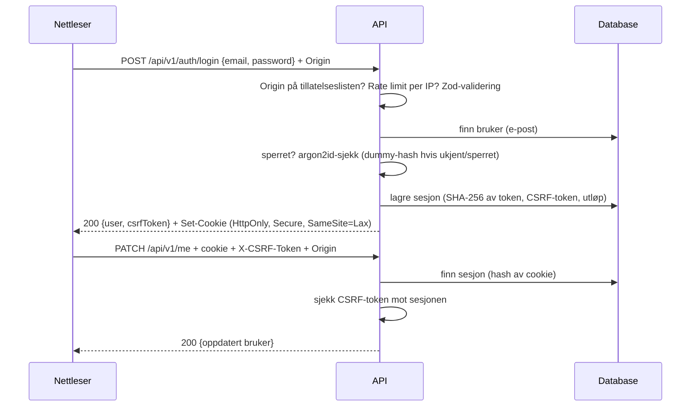
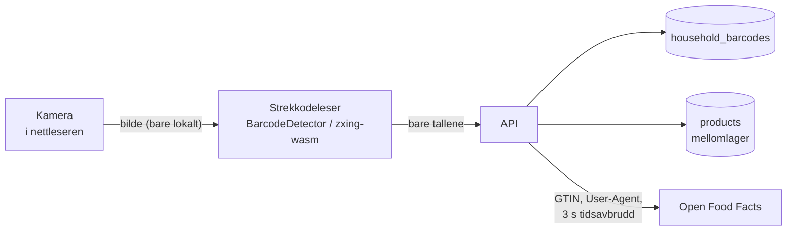
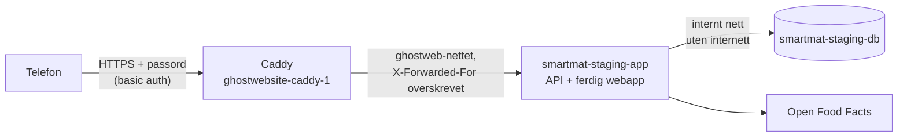
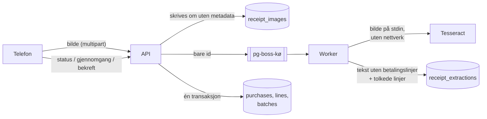
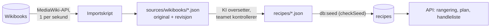

# Systemarkitektur

> **Status: UTKAST.** Første del skrevet etter fase 2 (2026-10-20), utvidet i fase 7 (2026-10-22). Arkitekturen og teksten er laget av KI (Claude) og
> ikke gjennomgått av teamet ennå. Kapittelet utvides når flere deler kommer til. Offisielle APP2000-krav til rapporten er
> ikke verifisert.

## Oversikt

SmartMat består av tre deler som kjører lokalt (ADR-0012):

| Del | Mappe | Teknologi | Ansvar |
|---|---|---|---|
| Web | `apps/web` | React, Vite, React Router, TanStack Query, i18next | Sider, skjemaer, validering for brukeren, visning |
| API | `apps/api` | Fastify, Zod, Prisma, argon2 | Forretningsregler, autorisasjon, validering (den som gjelder), sesjoner |
| Delt | `packages/shared` | Zod | Skjemaer, typer for API-svar, feilkoder, øre-hjelpere |
| Database | `prisma/`, `docker/` | PostgreSQL 16 i Docker | Lagring, fremmednøkler, unike og CHECK-begrensninger |

## Hvorfor én opprinnelse

Nettleseren snakker bare med Vite-serveren, som videresender `/api` til API-et. Sett fra nettleseren kommer appen og
API-et fra samme sted. Det gir tre fordeler:

- Sesjons-cookien er en vanlig førstepartscookie med `SameSite=Lax`.
- Vi trenger ikke CORS, som er en vanlig kilde til feil og sikkerhetshull.
- Origin-sjekken på serveren blir enkel: bare appens egen adresse er tillatt.

## API-et: ruter, service og repo (ADR-0002)

Hver modul i `apps/api/src/modules/` har tre lag:

| Lag | Fil | Ansvar | Vet om HTTP? | Vet om databasen? |
|---|---|---|---|---|
| Ruter | `routes.ts` | URL, skjema for inn/ut, statuskoder, cookie | ja | nei |
| Service | `service.ts` | Forretningsregler (sperre, utløp, passordsjekk) | nei | nei (bruker et repo-grensesnitt) |
| Repo | `repo.ts` | Prisma-spørringer og transaksjoner | nei | ja |

Fordi servicen bare kjenner et grensesnitt for repoet, kan reglene testes uten database. Det gjøres med falske repoer i
minnet (`src/test/fakes.ts`). Samme kode testes også mot en ekte database (`apps/api/test/`).

Felles deler ligger utenfor modulene:

- `plugins/origin.ts` (Origin-sjekk)
- `plugins/auth.ts` (sesjon, cookie og CSRF-token)
- `plugins/errors.ts` (ett feilformat)
- `authz/household.ts` (autorisasjon for husholdningsdata)

## Dataflyt: innlogging

## Eksterne tjenester bak et grensesnitt (fase 7)

Open Food Facts er den første eksterne tjenesten. API-et snakker bare med den gjennom `BarcodeProvider`
(`apps/api/src/providers/barcode/`). Nettleseren snakker aldri med den direkte, og kamerabildet forlater aldri
nettleseren.

Rekkefølgen er husholdningens egne svar, så mellomlageret, så OFF. Er OFF nede, får brukeren det tomme skjemaet, og
resten av appen merker ingenting (NFR-REL-001). I testene erstattes `fetch`, så OFF aldri kalles.

## Testmiljøet (fase 7, ADR-0015)

Et lukket testmiljø på `smartmat.risansolutions.no` gjør det mulig å teste kameraet på en ekte telefon. Kameraet
krever HTTPS. Det er bygd, men **ikke satt opp** per 2026-10-22, fordi DNS mangler.

Her serverer API-et også webappen, så det er fortsatt én opprinnelse. `trustProxy` stoler bare på `ghostweb`-nettet,
ellers ville alle brukere hatt samme IP-adresse (Caddy sin) og delt én rate limit.

## Kvitteringer i bakgrunnen (fase 8)

Å lese en kvittering tar 2–10 sekunder og rundt 50 MB minne. Det skjer derfor ikke i forespørselen, men i en egen
prosess, **workeren** (`apps/api/src/worker.ts`). API-et lagrer bildet og legger kvitteringens id i en kø
(pg-boss, i samme Postgres). Siden spør etter status hvert 2. sekund.

Workeren er et eget startpunkt i API-pakken, fordi den bruker samme databasekode. I testmiljøet er den en egen
container på det interne nettverket uten internett. Uten OCR (`OCR_PROVIDER=off`) tar API-et ikke imot kvitteringer,
og siden viser det vanlige skjemaet (NFR-REL-002).

## Oppskrifter fra åpne kilder og måltidsplan (fase 9)

**Oppskriftene** hentes ikke mens appen kjører. En utvikler kjører et importskript som henter sider fra Wikibooks
(CC BY-SA 4.0) og lagrer originalen med revisjons-id. KI oversetter dem til oppskriftsfiler, og `npm run db:seed`
legger dem inn som før (ADR-0016). Appen er derfor ikke avhengig av en ekstern tjeneste, og hver oppskrift kan
spores til akkurat den versjonen den er oversatt fra.

**Måltidsplanen** følger samme mønster som resten av API-et: ruter, service og repo, med de rene reglene i
`packages/shared/src/mealplan/`. Behovet lagres ikke. Det regnes ut ved hver forespørsel fra planen, oppskriftene,
matlageret og det planen allerede har lagt på handlelisten. Når noe legges på listen, skriver handlelistens repo både
linjen og bidraget i én transaksjon, med listen låst.

## Sikkerhetsgrenser

- **All tilgangskontroll skjer i API-et.** `RequireAuth` i React bestemmer bare hva som vises. Den beskytter ingenting.
- **Husholdningsdata:** ruter går gjennom `householdAccess`, som sjekker medlemskap i databasen (NFR-SEC-001).
  Mønsteret er beskrevet i [kapittel 10](10-teknisk-implementering.md#eksempel-6-autorisasjon-for-husholdningsdata).
- **Validering:** API-et validerer all input med de samme Zod-skjemaene som skjemaene i nettleseren (NFR-SEC-002).
- **Nettverk:** Lokalt lytter database og API bare på `127.0.0.1`. Maskinen kjører også andre nettsteder. I
  testmiljøet har ingen container en åpen port. Caddy når appen over Docker-nettet.

## Kilder i prosjektet

- [ADR-0001](../development/architecture-decisions/0001-monorepo-npm-workspaces.md),
  [ADR-0002](../development/architecture-decisions/0002-fastify-rest-api.md),
  [ADR-0003](../development/architecture-decisions/0003-postgresql-prisma.md),
  [ADR-0005](../development/architecture-decisions/0005-sesjoner-og-argon2id.md),
  [ADR-0008](../development/architecture-decisions/0008-husholdning-fra-start.md),
  [ADR-0012](../development/architecture-decisions/0012-lokal-utvikling-forst.md),
  [ADR-0014](../development/architecture-decisions/0014-produkter-og-strekkoder.md),
  [ADR-0015](../development/architecture-decisions/0015-lukket-testmiljo.md)
- [Fasespesifikasjon 02](../development/requirements/02-database-og-autentisering.md)
- [API-dokumentasjon](../development/api-documentation.md)
