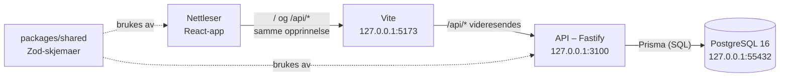
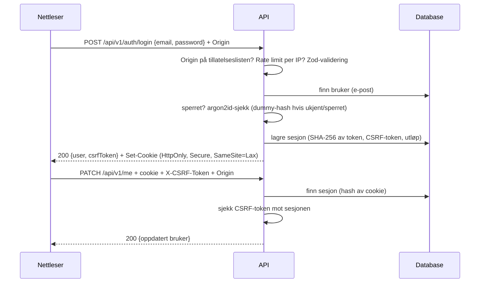

# Systemarkitektur

> **Status: UTKAST.** Første del skrevet etter fase 2 (2026-10-20). Arkitekturen og teksten er laget av KI (Claude) og
> ikke gjennomgått av teamet ennå. Kapittelet utvides når flere deler kommer til. Offisielle APP2000-krav til rapporten er
> ikke verifisert.

## Oversikt

SmartMat består av tre deler som kjører lokalt (ADR-0012):

| Del | Mappe | Teknologi | Ansvar |
|---|---|---|---|
| Web | `apps/web` | React, Vite, React Router, TanStack Query, i18next | Sider, skjemaer, validering for brukeren, visning |
| API | `apps/api` | Fastify, Zod, Prisma, argon2 | Forretningsregler, autorisasjon, validering (den som gjelder), sesjoner |
| Delt | `packages/shared` | Zod | Skjemaer, typer for API-svar, feilkoder, øre-hjelpere |
| Database | `prisma/`, `docker/` | PostgreSQL 16 i Docker | Lagring, fremmednøkler, unike og CHECK-begrensninger |

## Hvorfor én opprinnelse

Nettleseren snakker bare med Vite-serveren, som videresender `/api` til API-et. Sett fra nettleseren kommer appen og
API-et fra samme sted. Det gir tre fordeler:

- Sesjons-cookien er en vanlig førstepartscookie med `SameSite=Lax`.
- Vi trenger ikke CORS, som er en vanlig kilde til feil og sikkerhetshull.
- Origin-sjekken på serveren blir enkel: bare appens egen adresse er tillatt.

## API-et: ruter, service og repo (ADR-0002)

Hver modul i `apps/api/src/modules/` har tre lag:

| Lag | Fil | Ansvar | Vet om HTTP? | Vet om databasen? |
|---|---|---|---|---|
| Ruter | `routes.ts` | URL, skjema for inn/ut, statuskoder, cookie | ja | nei |
| Service | `service.ts` | Forretningsregler (sperre, utløp, passordsjekk) | nei | nei (bruker et repo-grensesnitt) |
| Repo | `repo.ts` | Prisma-spørringer og transaksjoner | nei | ja |

Fordi servicen bare kjenner et grensesnitt for repoet, kan reglene testes uten database. Det gjøres med falske repoer i
minnet (`src/test/fakes.ts`). Samme kode testes også mot en ekte database (`apps/api/test/`).

Felles deler ligger utenfor modulene:

- `plugins/origin.ts` (Origin-sjekk)
- `plugins/auth.ts` (sesjon, cookie og CSRF-token)
- `plugins/errors.ts` (ett feilformat)
- `authz/household.ts` (autorisasjon for husholdningsdata)

## Dataflyt: innlogging

## Sikkerhetsgrenser

- **All tilgangskontroll skjer i API-et.** `RequireAuth` i React bestemmer bare hva som vises. Den beskytter ingenting.
- **Husholdningsdata:** ruter går gjennom `householdAccess`, som sjekker medlemskap i databasen (NFR-SEC-001).
  Mønsteret er beskrevet i [kapittel 10](10-teknisk-implementering.md#eksempel-6-autorisasjon-for-husholdningsdata).
- **Validering:** API-et validerer all input med de samme Zod-skjemaene som skjemaene i nettleseren (NFR-SEC-002).
- **Nettverk:** Database og API lytter bare på `127.0.0.1`. Maskinen kjører også andre nettsteder.

## Kilder i prosjektet

- [ADR-0001](../development/architecture-decisions/0001-monorepo-npm-workspaces.md),
  [ADR-0002](../development/architecture-decisions/0002-fastify-rest-api.md),
  [ADR-0003](../development/architecture-decisions/0003-postgresql-prisma.md),
  [ADR-0005](../development/architecture-decisions/0005-sesjoner-og-argon2id.md),
  [ADR-0008](../development/architecture-decisions/0008-husholdning-fra-start.md),
  [ADR-0012](../development/architecture-decisions/0012-lokal-utvikling-forst.md)
- [Fasespesifikasjon 02](../development/requirements/02-database-og-autentisering.md)
- [API-dokumentasjon](../development/api-documentation.md)
