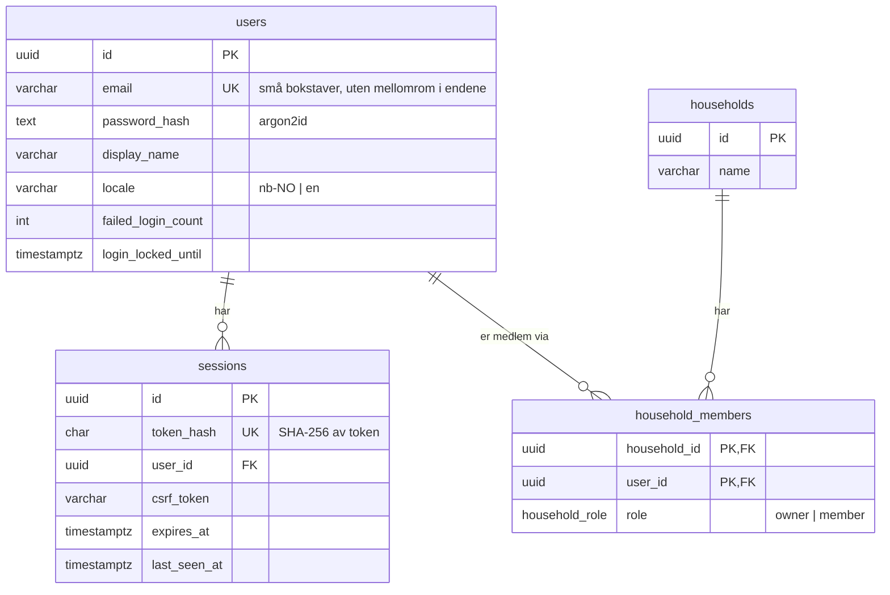
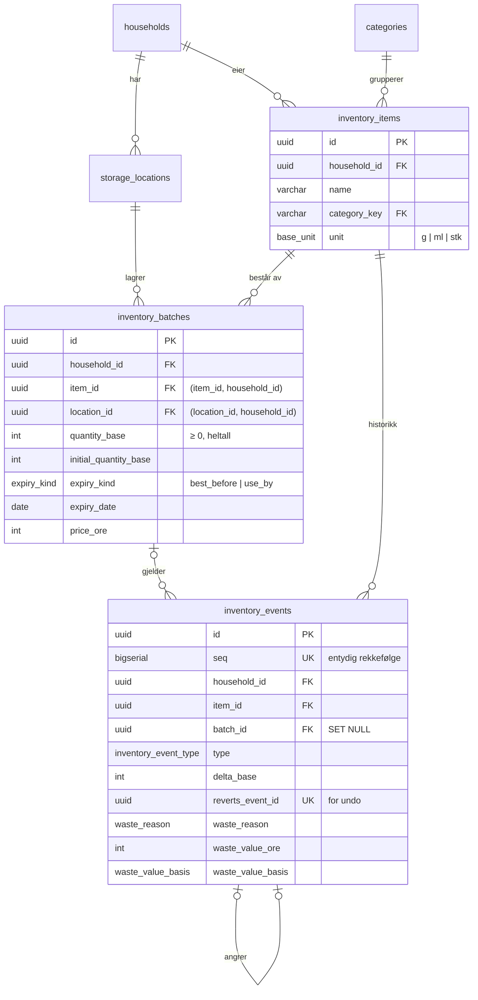
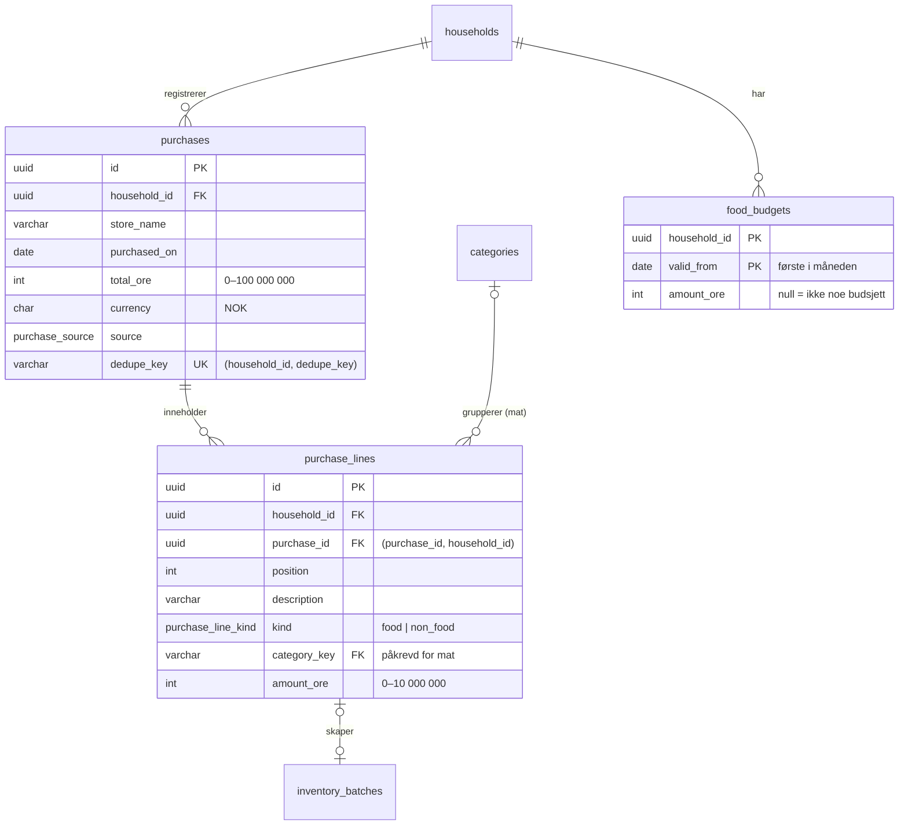
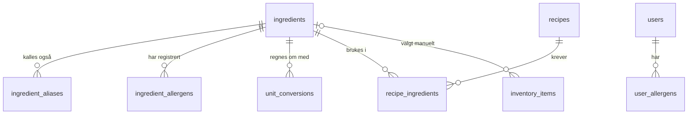
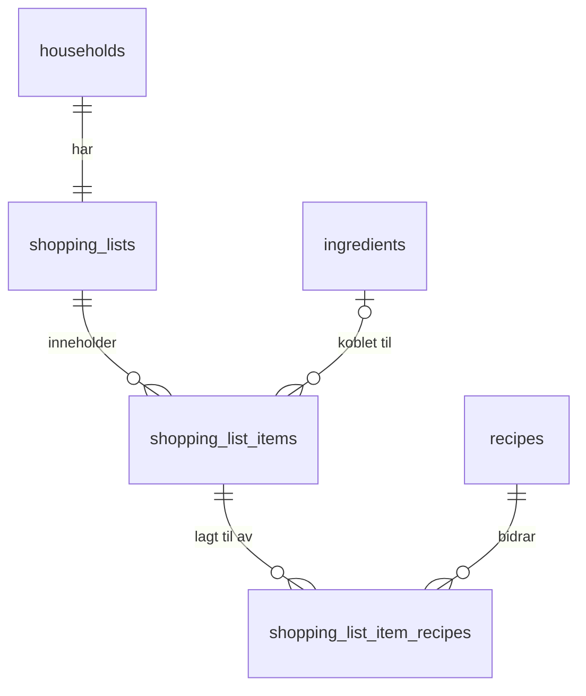
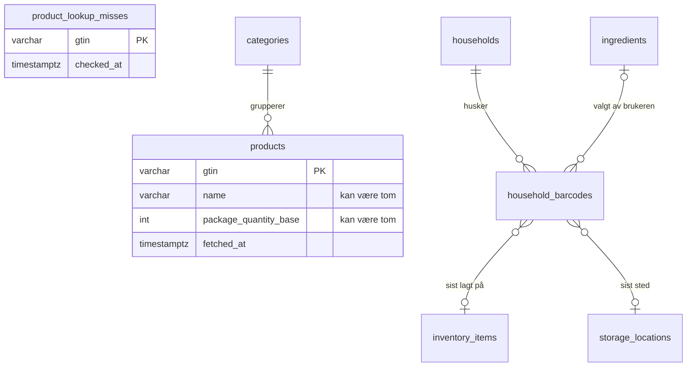

# Databasemodell

> **Status: UTKAST.** Skrevet etter fase 2 (2026-10-20), fase 3 og fase 4 (2026-10-21), utvidet i fase 5–12. Skjemaet og teksten er laget
> av KI (Claude) og ikke gjennomgått av teamet ennå. Kapittelet utvides med tabellene for oppskrifter i senere faser.
> Offisielle APP2000-krav til rapporten er ikke verifisert.

Fasiten er [`prisma/schema.prisma`](../../prisma/schema.prisma) og migreringene i
[`prisma/migrations/`](../../prisma/migrations/). Planen for hele modellen står i
[data-model.md](../development/data-model.md).

## Tabeller etter fase 2

## Tabeller for matlageret (fase 3)

### Husholdningen kan ikke blandes, heller ikke ved en feil i koden

Partier og hendelser har sin egen `household_id`. De peker til varen og stedet med **sammensatte fremmednøkler**
(`(item_id, household_id)` og `(location_id, household_id)`). Databasen nekter derfor å lagre et parti der varen
eller stedet tilhører en annen husholdning. En test prøver dette direkte mot databasen
(`inventory.security.api.test.ts`).

### Mengder og datoer
- Mengder er heltall i gram, milliliter eller stykk (ADR-0006). CHECK sørger for at mengden ikke er negativ.
- **Én dato per parti:** CHECK `(expiry_kind IS NULL) = (expiry_date IS NULL)` gjør at datoen alltid har en type,
  enten best før eller siste forbruksdag. De to blir aldri blandet.

### Hendelser og svinnlogg
- Hendelser legges bare til. «Angre» lager en ny hendelse (`undo`) som peker til den den angrer.
  `reverts_event_id` er unik, så samme hendelse kan ikke angres to ganger, heller ikke ved to samtidige klikk.
- CHECK-begrensninger sørger for at bare kasseringer har årsak og verdi, at verdien mangler hvis og bare hvis den er
  `unknown`, og at flytting har mengdeendring 0.
- Hendelser beholdes når et tomt parti slettes sammen med et lagringssted (`batch_id` settes til NULL), slik at
  svinnloggen ikke mister data.

### Sletting
`ON DELETE CASCADE` fra husholdningen tar alt lageret når en konto slettes (FR-AUTH-005). Fremmednøkkelen fra
parti til sted er `NO ACTION`, ikke `RESTRICT`. `NO ACTION` sjekkes først når hele SQL-setningen er ferdig, slik
at cascade fra husholdningen kan slette både partier og steder i samme setning.

## Tabeller for kjøp og budsjett (fase 4)

### Kjøpet er eneste kilde til utgifter (ADR-0007)
Ingen tabell lagrer «brukt denne måneden». Budsjettoversikten summerer linjene og kjøpene hver gang den vises. Når et
kjøp rettes eller slettes, er alle summer derfor riktige med en gang, uten noen egen oppdatering som kan glemmes.

### Kobling fra kjøp til lager
`inventory_batches.purchase_line_id` peker til linjen partiet kom fra. Fremmednøkkelen er sammensatt
(`(purchase_line_id, household_id)`), som for vare og sted, så et parti kan ikke kobles til et kjøp i en annen
husholdning. Den er unik, så en linje gir høyst ett parti. Koblingen er `NO ACTION`, ikke `SET NULL`: `SET NULL` på
en sammensatt nøkkel ville også tømt `household_id`. Koden fjerner derfor koblingen selv før den sletter en linje.

### Regler i databasen
- CHECK: beløpsgrenser, `currency = 'NOK'`, `(kind = 'food') = (category_key IS NOT NULL)`, og at `valid_from`
  er den første i måneden.
- `UNIQUE (household_id, dedupe_key)`: samme skjema sendt to ganger, også samtidig, gir ett kjøp (NFR-DATA-002).
- Totalsummen for et kjøp med linjer er summen av linjene. Dette sjekkes ikke av databasen (det ville krevd en
  trigger), men regnes alltid av serveren. En test sjekker at summene stemmer for hver måned.

### Budsjett som gjelder fra en måned
`food_budgets` har én rad per måned budsjettet ble endret. For en måned brukes raden med senest `valid_from` som ikke
er etter måneden. Endrer man budsjettet i november, beholder oktober det gamle beløpet.

## Oppskrifter og allergier (fase 5)

### Globale tabeller uten `household_id`
Oppskrifter og ingredienser er like for alle og hører ikke til en husholdning. De skrives bare av seed-skriptet
(`npm run db:seed`) fra JSON-filer i `prisma/seed/`, aldri gjennom API-et. Allergiene hører til brukeren
(`user_allergens`, ADR-0008), ikke husholdningen.

### Mengder og omregning (ADR-0006)
En ingrediens har én grunnenhet. `recipe_ingredients.quantity_base` står i den, som heltall, eller er tom («etter
smak»). Har en vare en annen enhet enn ingrediensen, brukes `unit_conversions` («1 stk egg ≈ 60 g» lagres som
`unit = g, unit_qty = 60, base_qty = 1`). Det er to heltall i stedet for en desimalfaktor, så ingen flyttall trengs.
Det svarer også på det åpne spørsmålet fra fase 0: omregningen gjelder per ingrediens, ikke per produkt.

### Kobling fra vare til ingrediens
Normalt skjer koblingen ved lesing, ut fra varenavnet og aliasene, og lagres ikke. Bare et valg brukeren har gjort,
lagres på varen: `ingredient_match` er `auto`, `manual` eller `none`, og CHECK-en
`(ingredient_match = 'manual') = (ingredient_id IS NOT NULL)` gjør at en ingrediens bare kan stå der når den er
valgt. Fremmednøkkelen er `RESTRICT`: seed-skriptet fjerner bare ingredienser som ingen vare er koblet til.

### Regler i databasen
- `ingredient_aliases.alias` er primærnøkkel: et alias kan bare høre til én ingrediens. CHECK sier at det er lagret
  normalisert (små bokstaver, uten mellomrom i endene).
- `recipe_ingredients` er unik per (oppskrift, ingrediens).
- CHECK: `cardinality(authors) >= 1` (ADR-0009: forfatteren må registreres), minst ett trinn, porsjoner 1–50,
  minutter 0–1440, omregningstall 1–100 000, mengder 1–100 000 000.
- `RESTRICT` fra `recipe_ingredients` til `ingredients`: en ingrediens som brukes i en oppskrift, kan ikke slettes.

## Handleliste (fase 6)

### Én liste, sammensatte fremmednøkler (ADR-0008)
`shopping_lists.household_id` er unik: hver husholdning har én liste (avgjørelse 1 i spesifikasjon 06). Listen lages
ved registreringen, og migreringen laget lister for husholdninger som fantes fra før. Linjene har `household_id` og
peker til listen med `(list_id, household_id)`. Bidragene peker til linjen med `(item_id, household_id)`. Databasen
kan derfor ikke koble en linje til en annen husholdnings liste.

### Én åpen linje per ingrediens
Den viktigste regelen er en **delvis unik indeks**: `UNIQUE (list_id, ingredient_id) WHERE NOT checked AND
ingredient_id IS NOT NULL`. Avhukede linjer og linjer uten ingrediens er ikke begrenset. Indeksen gjør at to
forespørsler som slår sammen samme oppskrift samtidig, aldri kan gi to åpne linjer for «melk». Koden låser i tillegg
listeraden (`SELECT … FOR UPDATE`), så sammenslåingen skjer én om gangen per husholdning. Prisma kan ikke uttrykke
delvise indekser, så den står som rå SQL i migreringen.

### Hvem la til hva
`shopping_list_item_recipes` har primærnøkkel `(item_id, recipe_id)`. Samme oppskrift kan derfor bare legge til én
gang på samme linje. Planen hadde én `source_recipe_id` på linjen, men da kunne ikke to oppskrifter dele en linje.
En oppskrift som fjernes av seed-skriptet, tar bidragene med seg (`CASCADE`). Linjen blir stående.

### Regler i databasen
- CHECK: mengde og enhet er satt sammen eller ikke i det hele tatt, mengden er 1–100 000 000, `checked_at` er satt
  når og bare når linjen er avhuket, og teksten er ikke tom.
- `dedupe_key` er unik per husholdning: samme skjema sendt to ganger gir én linje (NFR-DATA-002).
- `RESTRICT` fra linje til ingrediens. Seed-skriptet teller nå også handlelistelinjer før det fjerner en ingrediens.

## Strekkoder (fase 7)

### To slags data om en strekkode (ADR-0014)
- **`products` og `product_lookup_misses`** er et globalt mellomlager for Open Food Facts. Tabellene har ingen
  `household_id` og ingenting om brukere. Det er derfor greit at alle husholdninger deler dem: et oppslag én
  husholdning har gjort, koster ingenting for neste, og grensen mot OFF (15 i minuttet) nås ikke så lett.
- **`household_barcodes`** er det husholdningen selv har bekreftet. Primærnøkkelen er `(household_id, gtin)`. Navnet
  kan være skrevet av brukeren, så tabellen er husholdningsdata og slettes med husholdningen (`CASCADE`).

### Ingen `product_id` på varen
Planen fra fase 0 hadde `inventory_items.product_id`. Den ble ikke laget. Oppskriftene kobler varer til ingredienser
med navnet (spesifikasjon 05), og det navnet brukeren bekrefter for en skannet vare, matches likt. Det husholdningen
husker om koden, peker i stedet til varen (`household_barcodes.item_id`). Slik kan en vare ha mange strekkoder (to
merker melk), og en strekkode kan peke til en ny vare hvis den gamle slettes.

### Sammensatte fremmednøkler som kan være tomme
`(item_id, household_id)` og `(location_id, household_id)` gjør at en husket strekkode aldri kan peke til en annen
husholdnings vare eller sted. Begge kan være tomme. `SET NULL` kan ikke brukes på en sammensatt nøkkel, fordi det
også ville tømt `household_id`. Nøklene er derfor `NO ACTION`, og koden tømmer koblingen i samme transaksjon som den
sletter varen eller stedet. Det er det samme mønsteret som `purchase_line_id` i fase 4, og det er testet.

### Regler i databasen
- CHECK: GTIN er 8, 13 eller 14 sifre i alle tre tabellene. Navnet er ikke tomt, mengden er over 0, og en ingrediens
  står bare der når den er valgt manuelt (samme CHECK som på varen).
- CHECK på `products`: pakningsstørrelse og enhet er satt sammen eller ikke i det hele tatt.
- `inventory_batches.dedupe_key` er unik per husholdning (`scan:<clientRequestId>`): samme bekreftelse to ganger gir
  ett parti, også når de kommer samtidig.
- `RESTRICT` fra `household_barcodes` til `ingredients`. Seed-skriptet teller nå også huskede strekkoder før det
  fjerner en ingrediens.

### Kvitteringer (fase 8)

Tre tabeller, slik at det som er personlig kan slettes for seg:
- **`receipts`:** status og frister.
- **`receipt_images`:** bildet, som `bytea`.
- **`receipt_extractions`:** teksten og de tolkede linjene, som JSON.

Når kvitteringen bekreftes, slettes bilde og uttrekk i samme transaksjon som kjøpet lages. Bare raden i `receipts`
blir igjen, som koblingen til kjøpet. Bildene ligger i databasen og ikke som filer. Da forsvinner de med husholdningen
(cascade), det finnes ingen stier å misbruke, og ingen filer blir liggende igjen.

Duplikatnøkkelen ligger på kjøpet (`purchases.dedupe_key`), fordi det er kjøpet som ikke må finnes to ganger. Den er
en sha256 av kvitteringsnummer, klokkeslett, dato og total, så kvitteringsnummeret ikke står i klartekst.

### Måltidsplan og oppskriftskilder (fase 9)

- **`meal_plan_entries`:** én oppføring per dag og måltid. En CHECK sørger for at den enten er en oppskrift (med
  kopi av tittelen og antall porsjoner) eller fritekst. Når seed-skriptet fjerner en oppskrift, blir `recipe_id` tom
  (SET NULL), men tittelen står igjen, så brukeren ser hva som var planlagt.
- **`shopping_list_item_meals`:** hvor mye en planlagt rett har lagt på en handlelistelinje. Den gjør at samme behov
  ikke blir lagt til to ganger, og at bare økningen legges til hvis porsjonene økes. Sammensatte fremmednøkler med
  CASCADE til både linjen og oppføringen: slettes én av dem, forsvinner bidraget, men linjen eller oppføringen blir
  stående.
- **`recipes`** har fått feltene for kilde og lisens fra ADR-0016. En CHECK krever kilde, lenke, hentedato og
  tilpasning for eksterne oppskrifter.

Behovet for uka lagres ikke. Det regnes ut fra planen, oppskriftene og matlageret, som budsjettet i fase 4.

### Delte husholdninger (fase 10)

- **`household_invitations`:** en invitasjonslenke. Bare SHA-256 av tokenet lagres (`token_hash`, unik), som for
  sesjoner. Status (aktiv, brukt, tilbaketrukket, utløpt) regnes ut fra tre tidspunkter. En CHECK hindrer at en
  invitasjon er både brukt og tilbaketrukket. `created_by` og `used_by` blir tomme (SET NULL) hvis kontoen slettes.
- **`household_members.share_allergens`:** om medlemmets allergier skal telle for hele husholdningen. Standard
  `false`, fordi allergier kan være helseopplysninger.
- **Én eier:** den delvis unike indeksen `household_members_one_owner` (`WHERE role = 'owner'`) gjør at databasen
  selv nekter to eiere. En overføring setter derfor den gamle eieren til medlem før den nye blir eier.
- **`users.active_household_id`:** husholdningen brukeren valgte sist. Den er bare et ønske: hver gang sesjonen
  leses, sjekkes den mot medlemskapene, og den eldste husholdningen brukes hvis brukeren ikke er medlem lenger.
- **Låsing:** alle endringer i hvem som er medlem, låser husholdningsraden (`SELECT … FOR UPDATE`) i transaksjonen.
  To personer som godtar samme invitasjon samtidig, eller en overføring samtidig med en utmelding, skjer da etter
  hverandre.

### Varsler og svinn (fase 11)

- **Varsler lagres ikke** (ADR-0019). De regnes ut fra matlageret, budsjettet og handlelisten ved hver lesing, som
  budsjettet (ADR-0007). Det som lagres, er brukerens tilstand:
  - **`notification_states`** har primærnøkkelen `(user_id, household_id, key)`, så samme varsel kan bare være sett
    eller avvist én gang, også ved samtidige forespørsler (`ON CONFLICT`).
  - Den har en **sammensatt fremmednøkkel til `household_members (household_id, user_id)` med CASCADE**. Når et
    medlemskap slettes (utmelding, fjerning, sletting av husholdning eller konto), forsvinner tilstanden i samme
    setning. Databasen sørger dermed selv for at ingenting blir igjen.
  - En CHECK sier at nøkkelen bare har bokstaver, sifre, bindestrek og kolon.
- **`notification_settings`** er én rad per bruker. Uten rad brukes standarden, så eksisterende brukere trengte
  ingen data i migreringen. CHECK: `days_before` mellom 0 og 7.
- **`household_members.shopping_seen_at`** (standard `now()`): når medlemmet sist så handlelisten. Standardverdien gjør
  at gamle linjer ikke gir varsel, verken etter migreringen eller når noen blir med.
- **Svinnstatistikken** har ingen tabell. Den summeres fra `inventory_events` med `GROUP BY` per måned (norsk tid,
  `AT TIME ZONE 'Europe/Oslo'`), årsak, kategori, enhet og verditype.

### Priser (fase 12)

- **`price_observations`** og **`price_lookups`** er globale tabeller, som mellomlageret for Open Food Facts. De har
  ingen `household_id` og ingenting om brukere: en pris hos Meny for en strekkode er den samme for alle.
  - Én rad per kilde, strekkode og kjede (unik indeks). Et nytt svar sletter og skriver alle radene for strekkoden i
    én transaksjon, så en kjede som ikke lenger har prisen, forsvinner.
  - To tidspunkter: `observed_at` er når Kassalapp sist sjekket prisen, `fetched_at` er når vi hentet den. Det første
    avgjør om prisen er gammel (14 dager), det andre avgjør hurtiglageret (6 timer) og slettingen (30 dager).
  - Pakningsstørrelsen lagres i grunnenhet, ikke enhetsprisen. Enhetsprisen regnes ut med heltall når den vises.
  - CHECK: GTIN med 8, 13 eller 14 sifre, pris 0–10 000 000 øre, kjedekode med store bokstaver, sifre og `_`, og
    pakningsstørrelse med enhet eller ingen av dem.
- **Egne priser har ingen tabell.** De leses fra `inventory_batches` ved hver forespørsel, som budsjettet (ADR-0007).
  Retter brukeren prisen på et parti, er den egne prisen riktig med en gang.

## Viktige begrensninger

| Begrensning | Hvorfor |
|---|---|
| `users.email` er unik | Én konto per adresse. Dekker også to registreringer samtidig. |
| CHECK `email = lower(btrim(email))` | Databasen godtar ikke en adresse med store bokstaver, selv om koden skulle glemme å gjøre den om. |
| CHECK `locale IN ('nb-NO','en')` | Bare språk appen faktisk har |
| CHECK `failed_login_count >= 0` | Telleren for sperre kan ikke manipuleres til et negativt tall |
| CHECK `btrim(display_name) <> ''`, `btrim(name) <> ''` | Ingen tomme navn |
| Primærnøkkel (`household_id`, `user_id`) i `household_members` | Samme person kan ikke være medlem to ganger |
| Delvis unik indeks `household_members_one_owner` (fase 10) | Nøyaktig én eier per husholdning |
| `household_invitations.token_hash` er unik (fase 10) | En lenke peker på én invitasjon. Bare hashen lagres. |
| `ON DELETE CASCADE` fra `users` og `households` | Sletting av konto fjerner sesjoner og medlemskap. Sletting av en husholdning fjerner alt den eier (FR-AUTH-005). |
| `sessions.token_hash` er unik og indeksert | Hver forespørsel slår opp sesjonen på hash av cookien |

CHECK-begrensningene kan ikke uttrykkes i Prisma. De er skrevet som rå SQL nederst i migreringen (ADR-0003).

## Husholdningsisolasjon (ADR-0008)

Alle tabeller med husholdningsdata har `household_id`: matlageret fra fase 3, og kjøp, linjer og budsjett fra fase 4. Oppskriftstabellene fra fase 5 er globale, og allergiene er knyttet til brukeren.

- Hver bruker får en husholdning ved registrering, i samme transaksjon som brukeren, sammen med tre standardsteder.
- Tilgang avgjøres av en rad i `household_members`, ikke av hvem som opprettet noe.
- Når deling kommer i fase 10, trengs bare nye medlemsrader. Tabellene og spørringene trenger ikke endres.
  **Slik ble det:** fase 10 la ikke `household_id` til noen tabell. Det som er nytt, er invitasjoner, roller,
  aktiv husholdning og deling av allergier (ADR-0018).

## ID-er

Alle ID-er er UUID versjon 7 (`uuid(7)` i Prisma). De kan ikke gjettes eller telles, slik løpenumre kan. Version 7
er sortert etter tid, noe som gir bedre indekser enn helt tilfeldige UUID-er.

## Migreringer

| Migrering | Innhold |
|---|---|
| `20261020130340_init_auth` | De fire tabellene, enum `household_role`, indekser, fremmednøkler og CHECK-begrensninger |
| `20261021114832_inventory` | Matlageret: 5 tabeller, 6 enums, sammensatte fremmednøkler, CHECK, 12 kategorier, standardsteder for eksisterende husholdninger |
| `20261021115500_inventory_event_seq` | Løpenummer på hendelser (se under) |
| `20261021124836_purchases_budget` | Kjøp, linjer og matbudsjett: 3 tabeller, 2 enums, `purchase_line_id` på partier, sammensatte fremmednøkler og CHECK |
| `20261021153638_recipes` | Oppskrifter: 7 tabeller, 3 enums, `ingredient_match`/`ingredient_id` på varer, CHECK. Innholdet legges inn med `npm run db:seed`, ikke av migreringen. |
| `20261021200000_shopping_list` | Handleliste: 3 tabeller, sammensatte fremmednøkler, CHECK, delvis unik indeks (én åpen linje per ingrediens) og én liste for hver husholdning som fantes |
| `20261022000000_barcodes` | Strekkoder: `products`, `product_lookup_misses`, `household_barcodes` og `inventory_batches.dedupe_key` |
| `20261024120000_receipts` | Kvitteringer: 3 tabeller, enum `receipt_status`, sammensatte fremmednøkler (også `(purchase_id, household_id)` med `ON DELETE CASCADE`) og CHECK (feilkode bare ved `failed`, bekreftet bare med kjøp og uten bildehash, bildestørrelse, sikkerhet 0–100) |
| `20261024150000_recipe_sources` | Kilde og lisens på oppskrifter: enum `recipe_adaptation`, verdien `external` i `recipe_source`, 8 kolonner og CHECK (ekstern krever kilde; kontrollert krever dato) |
| `20261024180000_meal_plan` | Måltidsplan: `meal_plan_entries`, `shopping_list_item_meals`, enum `meal`, sammensatte fremmednøkler, `recipe_id` med SET NULL, CHECK (oppskrift eller fritekst, porsjoner 1–50, positiv mengde) |
| `20261024210000_households_sharing` | Delte husholdninger: `household_invitations`, `share_allergens`, `active_household_id`, indeksen for én eier og CHECK (ikke både brukt og tilbaketrukket, `used_by` bare med `used_at`) |
| `20261025120000_notifications` | Varsler: `notification_settings`, `notification_states` (sammensatt fremmednøkkel til medlemskapet med CASCADE), `shopping_seen_at` og CHECK (dager før 0–7, nøkkelformat) |
| `20261025150000_prices` | Priser: `price_observations`, `price_lookups`, enum `price_source` og CHECK (GTIN, pris, kjedekode, pakningsstørrelse) |

**Om den tredje migreringen:** `seq` ble lagt til etter at matlagermigreringen var kjørt i utviklingsdatabasen.
`prisma migrate reset` nekter å kjøre når den startes av et KI-verktøy, fordi kommandoen sletter data. Derfor ble
endringen en egen migrering, skrevet med `prisma migrate diff`, i stedet for å lage den første på nytt.

Kommandoer: `npm run db:migrate` (utvikling), `npm run db:deploy` (bare kjøre ferdige migreringer).
Testene kjører `prisma migrate deploy` mot sine egne databaser før de starter.

## Kilder i prosjektet

- [ADR-0003](../development/architecture-decisions/0003-postgresql-prisma.md),
  [ADR-0005](../development/architecture-decisions/0005-sesjoner-og-argon2id.md),
  [ADR-0008](../development/architecture-decisions/0008-husholdning-fra-start.md)
- [Fasespesifikasjon 02](../development/requirements/02-database-og-autentisering.md)
- [Migreringsstatus (bevis)](../evidence/test-results/fase-2/09-migrate-status.txt)
