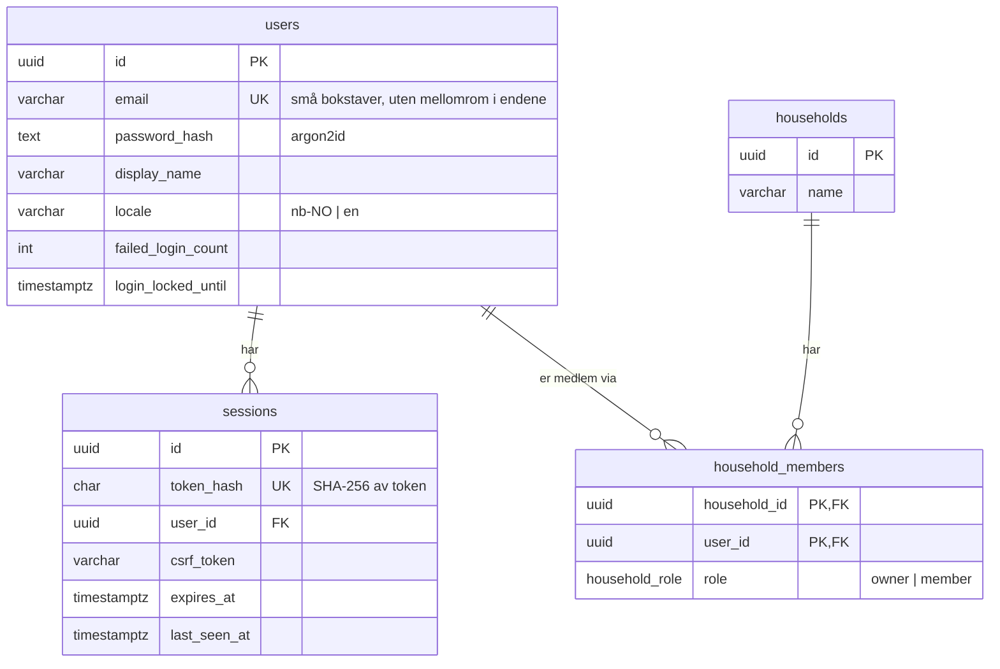
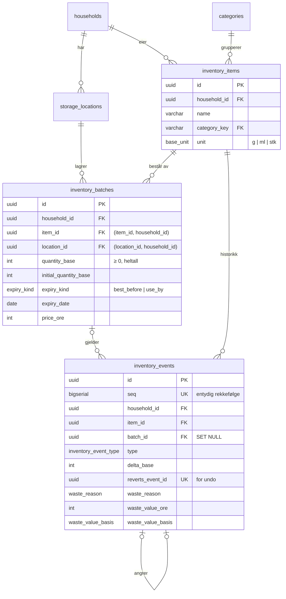
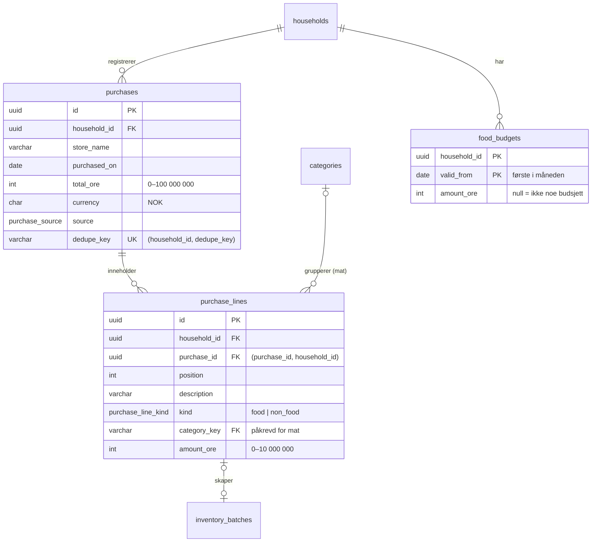

# Databasemodell

> **Status: UTKAST.** Skrevet etter fase 2 (2026-10-20), fase 3 og fase 4 (2026-10-21). Skjemaet og teksten er laget
> av KI (Claude) og ikke gjennomgått av teamet ennå. Kapittelet utvides med tabellene for oppskrifter i senere faser.
> Offisielle APP2000-krav til rapporten er ikke verifisert.

Fasiten er [`prisma/schema.prisma`](../../prisma/schema.prisma) og migreringene i
[`prisma/migrations/`](../../prisma/migrations/). Planen for hele modellen står i
[data-model.md](../development/data-model.md).

## Tabeller etter fase 2

## Tabeller for matlageret (fase 3)

### Husholdningen kan ikke blandes, heller ikke ved en feil i koden

Partier og hendelser har sin egen `household_id`. De peker til varen og stedet med **sammensatte fremmednøkler**
(`(item_id, household_id)` og `(location_id, household_id)`). Databasen nekter derfor å lagre et parti der varen
eller stedet tilhører en annen husholdning. En test prøver dette direkte mot databasen
(`inventory.security.api.test.ts`).

### Mengder og datoer
- Mengder er heltall i gram, milliliter eller stykk (ADR-0006). CHECK sørger for at mengden ikke er negativ.
- **Én dato per parti:** CHECK `(expiry_kind IS NULL) = (expiry_date IS NULL)` gjør at datoen alltid har en type,
  enten best før eller siste forbruksdag. De to blir aldri blandet.

### Hendelser og svinnlogg
- Hendelser legges bare til. «Angre» lager en ny hendelse (`undo`) som peker til den den angrer.
  `reverts_event_id` er unik, så samme hendelse kan ikke angres to ganger, heller ikke ved to samtidige klikk.
- CHECK-begrensninger sørger for at bare kasseringer har årsak og verdi, at verdien mangler hvis og bare hvis den er
  `unknown`, og at flytting har mengdeendring 0.
- Hendelser beholdes når et tomt parti slettes sammen med et lagringssted (`batch_id` settes til NULL), slik at
  svinnloggen ikke mister data.

### Sletting
`ON DELETE CASCADE` fra husholdningen tar alt lageret når en konto slettes (FR-AUTH-005). Fremmednøkkelen fra
parti til sted er `NO ACTION`, ikke `RESTRICT`. `NO ACTION` sjekkes først når hele SQL-setningen er ferdig, slik
at cascade fra husholdningen kan slette både partier og steder i samme setning.

## Tabeller for kjøp og budsjett (fase 4)

### Kjøpet er eneste kilde til utgifter (ADR-0007)
Ingen tabell lagrer «brukt denne måneden». Budsjettoversikten summerer linjene og kjøpene hver gang den vises. Når et
kjøp rettes eller slettes, er alle summer derfor riktige med en gang, uten noen egen oppdatering som kan glemmes.

### Kobling fra kjøp til lager
`inventory_batches.purchase_line_id` peker til linjen partiet kom fra. Fremmednøkkelen er sammensatt
(`(purchase_line_id, household_id)`), som for vare og sted, så et parti kan ikke kobles til et kjøp i en annen
husholdning. Den er unik, så en linje gir høyst ett parti. Koblingen er `NO ACTION`, ikke `SET NULL`: `SET NULL` på
en sammensatt nøkkel ville også tømt `household_id`. Koden fjerner derfor koblingen selv før den sletter en linje.

### Regler i databasen
- CHECK: beløpsgrenser, `currency = 'NOK'`, `(kind = 'food') = (category_key IS NOT NULL)`, og at `valid_from`
  er den første i måneden.
- `UNIQUE (household_id, dedupe_key)`: samme skjema sendt to ganger, også samtidig, gir ett kjøp (NFR-DATA-002).
- Totalsummen for et kjøp med linjer er summen av linjene. Dette sjekkes ikke av databasen (det ville krevd en
  trigger), men regnes alltid av serveren. En test sjekker at summene stemmer for hver måned.

### Budsjett som gjelder fra en måned
`food_budgets` har én rad per måned budsjettet ble endret. For en måned brukes raden med senest `valid_from` som ikke
er etter måneden. Endrer man budsjettet i november, beholder oktober det gamle beløpet.

## Viktige begrensninger

| Begrensning | Hvorfor |
|---|---|
| `users.email` er unik | Én konto per adresse. Dekker også to registreringer samtidig. |
| CHECK `email = lower(btrim(email))` | Databasen godtar ikke en adresse med store bokstaver, selv om koden skulle glemme å gjøre den om. |
| CHECK `locale IN ('nb-NO','en')` | Bare språk appen faktisk har |
| CHECK `failed_login_count >= 0` | Telleren for sperre kan ikke manipuleres til et negativt tall |
| CHECK `btrim(display_name) <> ''`, `btrim(name) <> ''` | Ingen tomme navn |
| Primærnøkkel (`household_id`, `user_id`) i `household_members` | Samme person kan ikke være medlem to ganger |
| `ON DELETE CASCADE` fra `users` og `households` | Sletting av konto fjerner sesjoner og medlemskap. Sletting av en husholdning fjerner alt den eier (FR-AUTH-005). |
| `sessions.token_hash` er unik og indeksert | Hver forespørsel slår opp sesjonen på hash av cookien |

CHECK-begrensningene kan ikke uttrykkes i Prisma. De er skrevet som rå SQL nederst i migreringen (ADR-0003).

## Husholdningsisolasjon (ADR-0008)

Alle tabeller med brukerdata har `household_id`: matlageret fra fase 3, og kjøp, linjer og budsjett fra fase 4.

- Hver bruker får en husholdning ved registrering, i samme transaksjon som brukeren, sammen med tre standardsteder.
- Tilgang avgjøres av en rad i `household_members`, ikke av hvem som opprettet noe.
- Når deling kommer i fase 10, trengs bare nye medlemsrader. Tabellene og spørringene trenger ikke endres.

## ID-er

Alle ID-er er UUID versjon 7 (`uuid(7)` i Prisma). De kan ikke gjettes eller telles, slik løpenumre kan. Version 7
er sortert etter tid, noe som gir bedre indekser enn helt tilfeldige UUID-er.

## Migreringer

| Migrering | Innhold |
|---|---|
| `20261020130340_init_auth` | De fire tabellene, enum `household_role`, indekser, fremmednøkler og CHECK-begrensninger |
| `20261021114832_inventory` | Matlageret: 5 tabeller, 6 enums, sammensatte fremmednøkler, CHECK, 12 kategorier, standardsteder for eksisterende husholdninger |
| `20261021115500_inventory_event_seq` | Løpenummer på hendelser (se under) |
| `20261021124836_purchases_budget` | Kjøp, linjer og matbudsjett: 3 tabeller, 2 enums, `purchase_line_id` på partier, sammensatte fremmednøkler og CHECK |

**Om den tredje migreringen:** `seq` ble lagt til etter at matlagermigreringen var kjørt i utviklingsdatabasen.
`prisma migrate reset` nekter å kjøre når den startes av et KI-verktøy, fordi kommandoen sletter data. Derfor ble
endringen en egen migrering, skrevet med `prisma migrate diff`, i stedet for å lage den første på nytt.

Kommandoer: `npm run db:migrate` (utvikling), `npm run db:deploy` (bare kjøre ferdige migreringer).
Testene kjører `prisma migrate deploy` mot sine egne databaser før de starter.

## Kilder i prosjektet

- [ADR-0003](../development/architecture-decisions/0003-postgresql-prisma.md),
  [ADR-0005](../development/architecture-decisions/0005-sesjoner-og-argon2id.md),
  [ADR-0008](../development/architecture-decisions/0008-husholdning-fra-start.md)
- [Fasespesifikasjon 02](../development/requirements/02-database-og-autentisering.md)
- [Migreringsstatus (bevis)](../evidence/test-results/fase-2/09-migrate-status.txt)
