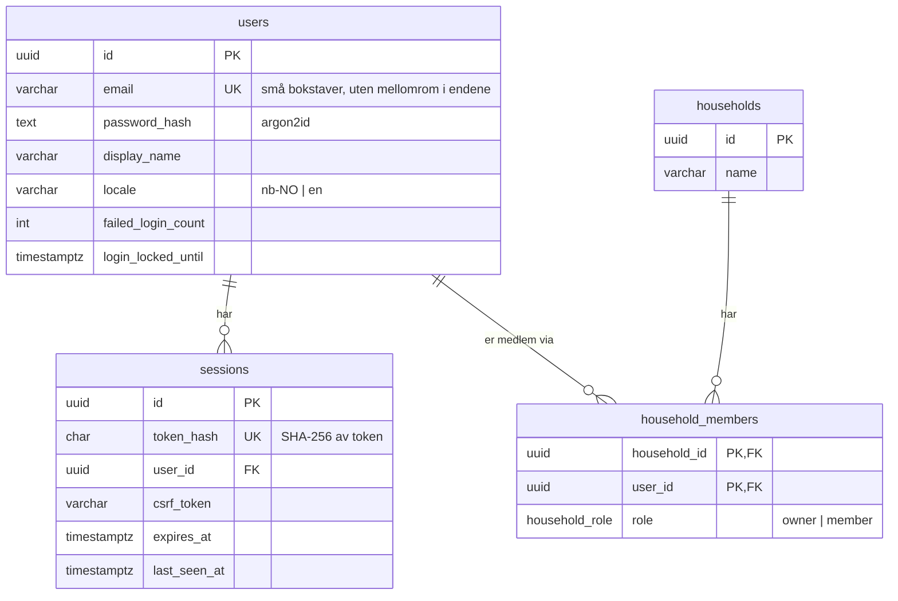

# Databasemodell

> **Status: UTKAST.** Første del skrevet etter fase 2 (2026-10-20). Skjemaet og teksten er laget av KI (Claude) og
> ikke gjennomgått av teamet ennå. Kapittelet utvides med tabellene for matlager, kjøp og oppskrifter i senere faser.
> Offisielle APP2000-krav til rapporten er ikke verifisert.

Fasiten er [`prisma/schema.prisma`](../../prisma/schema.prisma) og migreringene i
[`prisma/migrations/`](../../prisma/migrations/). Planen for hele modellen står i
[data-model.md](../development/data-model.md).

## Tabeller etter fase 2

## Viktige begrensninger

| Begrensning | Hvorfor |
|---|---|
| `users.email` er unik | Én konto per adresse. Dekker også to registreringer samtidig. |
| CHECK `email = lower(btrim(email))` | Databasen godtar ikke en adresse med store bokstaver, selv om koden skulle glemme å gjøre den om. |
| CHECK `locale IN ('nb-NO','en')` | Bare språk appen faktisk har |
| CHECK `failed_login_count >= 0` | Telleren for sperre kan ikke manipuleres til et negativt tall |
| CHECK `btrim(display_name) <> ''`, `btrim(name) <> ''` | Ingen tomme navn |
| Primærnøkkel (`household_id`, `user_id`) i `household_members` | Samme person kan ikke være medlem to ganger |
| `ON DELETE CASCADE` fra `users` og `households` | Sletting av konto fjerner sesjoner og medlemskap. Sletting av en husholdning fjerner alt den eier (FR-AUTH-005). |
| `sessions.token_hash` er unik og indeksert | Hver forespørsel slår opp sesjonen på hash av cookien |

CHECK-begrensningene kan ikke uttrykkes i Prisma. De er skrevet som rå SQL nederst i migreringen (ADR-0003).

## Husholdningsisolasjon (ADR-0008)

Brukerdata som matlager og kjøp kommer fra fase 3 og skal ligge i tabeller med `household_id`. Det er gjort
klart allerede nå:

- Hver bruker får en husholdning ved registrering, i samme transaksjon som brukeren.
- Tilgang avgjøres av en rad i `household_members`, ikke av hvem som opprettet noe.
- Når deling kommer i fase 10, trengs bare nye medlemsrader. Tabellene og spørringene trenger ikke endres.

## ID-er

Alle ID-er er UUID versjon 7 (`uuid(7)` i Prisma). De kan ikke gjettes eller telles, slik løpenumre kan. Version 7
er sortert etter tid, noe som gir bedre indekser enn helt tilfeldige UUID-er.

## Migreringer

| Migrering | Innhold |
|---|---|
| `20261020130340_init_auth` | De fire tabellene, enum `household_role`, indekser, fremmednøkler og CHECK-begrensninger |

Kommandoer: `npm run db:migrate` (utvikling), `npm run db:deploy` (bare kjøre ferdige migreringer).
Testene kjører `prisma migrate deploy` mot sine egne databaser før de starter.

## Kilder i prosjektet

- [ADR-0003](../development/architecture-decisions/0003-postgresql-prisma.md),
  [ADR-0005](../development/architecture-decisions/0005-sesjoner-og-argon2id.md),
  [ADR-0008](../development/architecture-decisions/0008-husholdning-fra-start.md)
- [Fasespesifikasjon 02](../development/requirements/02-database-og-autentisering.md)
- [Migreringsstatus (bevis)](../evidence/test-results/fase-2/09-migrate-status.txt)
