# Datamodell (utkast, fase 0)

**Status:** UTKAST. Dette er en plan for hvordan dataene henger sammen, ikke det endelige skjemaet. Tabellene opprettes
i den fasen de trengs (se kolonnen *Fase*). Skjemaet i [`prisma/schema.prisma`](../../prisma/schema.prisma) er fasiten
for tabellene som finnes.

**Implementert i fase 2 (2026-10-20):** `User`, `Household`, `HouseholdMember` og `Session`. Avvik fra planen:
`User` fikk også `failed_login_count` og `login_locked_until` (FR-AUTH-003), og `Session` fikk `csrf_token`. `currency`
er ikke lagt til ennå, fordi ingenting bruker den før fase 4. `AuditEvent` er utsatt til fase 3. Se
[kapittel 8](../academic/08-databasemodell.md).

**Implementert i fase 3 (2026-10-21):** `Category`, `StorageLocation`, `InventoryItem`, `InventoryBatch` og
`InventoryEvent`. Avvik fra planen:
- `Product` og `ProductBarcode` er utsatt til fase 7, så varen har et fritt navn (beslutning 1 i spesifikasjon 03).
- `FoodWasteEvent` er slått sammen med `InventoryEvent`. Kassering lagrer årsak og verdi i samme rad, med CHECK.
- Partiet har én dato med type (`expiry_kind` + `expiry_date`) i stedet for `best_before` og `use_by`.
- `AuditEvent` droppes; `inventory_events` er historikken (beslutning 5).

**Implementert i fase 4 (2026-10-21):** `Purchase`, `PurchaseLine` og `FoodBudget`, og `purchase_line_id` på
`InventoryBatch`. Avvik fra planen:
- `PurchaseLine` har `kind` (`food`/`nonFood`), `category_key` og `amount_ore` i stedet for `product_id`, `quantity`,
  `unit_price_ore`, `discount_ore`, `is_food` og `is_deposit`. Rabatt og pant føres som nettobeløp (avgjørelse 5 i
  spesifikasjon 04). Mengden står på partiet, ikke på linjen.
- `Budget` heter `FoodBudget` og har bare `household_id`, `valid_from` (første dag i måneden) og `amount_ore`
  (null = ikke noe budsjett). Budsjett per bruker og per kategori er utsatt (avgjørelse 8).
- Koblingen går fra parti til linje (`inventory_batches.purchase_line_id`, unik, sammensatt fremmednøkkel med
  `household_id`), ikke fra linje til parti.
- `dedupe_key` er unik per husholdning, ikke globalt.

**Implementert i fase 5 (2026-10-21):** `Ingredient`, `IngredientAlias`, `UnitConversion`, `Recipe` og
`RecipeIngredient`, og i tillegg `IngredientAllergen`, `UserAllergen` og `ingredient_id`/`ingredient_match` på
`InventoryItem`. Avvik fra planen:
- `UnitConversion` gjelder alltid én ingrediens (`ingredient_id` er påkrevd) og har to heltall (`unit_qty`, `base_qty`)
  i stedet for en `to_base_factor`. Omregning mellom g og kg, ml og dl osv. ligger i koden, ikke i tabellen.
- `IngredientAlias` har aliaset som primærnøkkel, så det er unikt på tvers av alle ingredienser. Navnet lagres også
  som alias.
- `Recipe` har `authors` (påkrevd, ADR-0009), `slug` (stabil id i frødatafilene), `steps` som liste og ikke `image`.
  `source` er `team` eller `test`.
- `RecipeIngredient` har `position` og er unik per (oppskrift, ingrediens). `quantity_base` er null for «etter smak».
- Oppskriftens allergener lagres ikke. De regnes ut fra ingrediensene (`ingredient_allergens`).
- Allergier er en egen tabell `user_allergens` knyttet til brukeren, som planen sa.
- `InventoryItem` fikk `ingredient_match` (`auto`/`manual`/`none`) og `ingredient_id` (bare ved `manual`, CHECK).

**Implementert i fase 6 (2026-10-21):** `ShoppingList`, `ShoppingListItem` og i tillegg `ShoppingListItemRecipe`.
Avvik fra planen:
- `ShoppingList` har bare `household_id` (unik): én liste per husholdning (avgjørelse 1 i spesifikasjon 06). Lister
  for husholdninger som fantes fra før, lages av migreringen.
- `ShoppingListItem` har `quantity_base` + `unit` (begge eller ingen, CHECK), `checked_at` (CHECK: satt når og bare
  når linjen er avhuket), `dedupe_key` (unik per husholdning) og `created_by`. `product_id` er utelatt (ingen
  produktkatalog før fase 7). `source_recipe_id` er erstattet av tabellen `ShoppingListItemRecipe`, fordi flere
  oppskrifter kan legge til på samme linje.
- En **delvis unik indeks** tillater bare én åpen linje per ingrediens (`WHERE NOT checked AND ingredient_id IS NOT
  NULL`). Sammenslåing fra oppskrifter bygger på den.
- `ShoppingListItemRecipe` (`item_id`, `recipe_id`, `quantity_base`) har primærnøkkel `(item_id, recipe_id)`, så
  samme oppskrift aldri teller to ganger på en linje.

**Implementert i fase 7 (2026-10-22):** `Product`, `ProductLookupMiss` og `HouseholdBarcode`, og `dedupe_key` på
`InventoryBatch` ([ADR-0014](architecture-decisions/0014-produkter-og-strekkoder.md)). Avvik fra planen:
- `Product` er et **globalt mellomlager** for Open Food Facts, med GTIN som primærnøkkel. Det har ingen
  `household_id` og ingen kobling til ingredienser. `ProductBarcode` er ikke laget: OFF har én kode per produkt.
- `ProductLookupMiss` (`gtin`, `checked_at`) husker koder OFF ikke kjente, i 24 timer. Feil lagres aldri.
- `HouseholdBarcode` (`household_id`, `gtin`) er det husholdningen bekreftet sist: navn, kategori, enhet, mengde,
  ingrediensvalg (samme CHECK som på varen), sted, datotype og varen. Den er det eneste stedet en ukjent kode huskes.
  Sted og vare er sammensatte fremmednøkler med `NoAction`, og koden tømmer dem før en vare eller et sted slettes.
- `InventoryItem` fikk **ikke** `product_id`: varen kobles til ingrediensen med navnet, som før (spesifikasjon 05).
- `inventory_batches.dedupe_key` (unik per husholdning, kan være tom) gjør at en bekreftelse sendt to ganger gir
  ett parti.

**Implementert i fase 8 (2026-10-24):** `Receipt`, `ReceiptImage` og `ReceiptExtraction`
([spesifikasjon 08](requirements/08-kvittering.md), ADR-0017). Avvik fra planen:
- Planen hadde «Receipt og ReceiptExtraction». **Bildet ligger i en egen tabell** (`receipt_images`, `bytea`), så
  det kan slettes for seg og aldri leses ved et uhell sammen med kvitteringen. Ingen filer på disk.
- `Receipt` har `status` (`queued`/`processing`/`review`/`failed`/`confirmed`, CHECK med `failure_code`),
  `delete_after` (opplasting + 7 dager), `image_sha256` (samme bilde to ganger) og `purchase_id`.
- **Etter bekreftelse** blir bare `receipts`-raden igjen, med kobling til kjøpet. Bilde og uttrekk slettes i
  samme transaksjon som kjøpet lages.
- `purchase_id` er en sammensatt fremmednøkkel `(purchase_id, household_id)` med **`ON DELETE CASCADE`**: slettes
  kjøpet, slettes kvitteringsraden, og kvitteringen kan importeres på nytt.
- **Duplikatnøkkelen ligger på kjøpet** (`purchases.dedupe_key`), ikke på kvitteringen: `receipt:<sha256>` når
  kvitteringsnummer og klokkeslett er lest, ellers `receipt-id:<id>`.
- `ReceiptExtraction.raw_text` lagres uten betalingslinjer. `parsed` er JSON med tolkede linjer og konfidens.
- **pg-boss** har sitt eget skjema `pgboss` i samme database. Jobbene inneholder bare kvitteringens id.

**Implementert i fase 9 (2026-10-24):** `MealPlanEntry` og i tillegg `ShoppingListItemMeal`, og nye felt på `Recipe`
([spesifikasjon 09](requirements/09-maltidsplan.md), ADR-0016). Avvik fra planen:
- `MealPlanEntry` har `meal` (`breakfast`/`lunch`/`dinner`), enten `recipe_id` + `recipe_title` + `servings` eller
  `note` (CHECK), og `dedupe_key` unik per husholdning. `recipe_title` er en kopi, så oppføringen beholder navnet hvis
  seed-skriptet fjerner oppskriften (`recipe_id` SET NULL). `position` fra planen er ikke laget: rekkefølgen innenfor
  et måltid er rekkefølgen oppføringene ble lagt til.
- `ShoppingListItemMeal` (`item_id`, `entry_id`, `household_id`, `quantity_base`) sier hvor mye en oppføring har lagt
  på en handlelistelinje. Den trekkes fra neste gang, så samme behov lagt til to ganger blir ikke doblet. Sammensatte
  fremmednøkler med CASCADE til både linjen og oppføringen.
- `Recipe` fikk `source_title`, `source_url`, `retrieved_on`, `adaptation`, `adaptation_note`, `ai_assisted`,
  `reviewed_by` og `reviewed_on`, og `source` kan være `external`. CHECK: en ekstern oppskrift har kilde, lenke,
  hentedato og tilpasning, og `reviewed_on` står når og bare når `reviewed_by` har navn. `original_author` fra
  ADR-0016 er ikke laget (`authors` har den rollen).

**Implementert i fase 10 (2026-10-24):** `Invitation` (som `HouseholdInvitation`), og nye felt på
`HouseholdMember` og `User` ([spesifikasjon 10](requirements/10-husholdning.md), ADR-0018). Avvik fra planen:
- `household_invitations` har bare `token_hash` (SHA-256), ikke selve tokenet. Status regnes ut fra `used_at`,
  `revoked_at` og `expires_at`. CHECK: ikke både brukt og tilbaketrukket. Rader eldre enn 30 dager slettes når en ny
  invitasjon lages.
- `household_members.share_allergens` (standard `false`): deling av allergier per husholdning (FR-HH-006).
- **Nøyaktig én eier:** delvis unik indeks `household_members_one_owner` på `household_id` der `role = 'owner'`.
- `users.active_household_id` (SET NULL) er husholdningen brukeren valgte sist. Den sjekkes mot medlemskapet ved hver
  lesing.
- Ingen tabeller fikk ny `household_id`: ADR-0008 hadde lagt det inn fra start.

**Implementert i fase 11 (2026-10-25):** `NotificationSettings` og `NotificationState`, og
`household_members.shopping_seen_at` ([spesifikasjon 11](requirements/11-svinn-og-varsler.md), ADR-0019). Avvik
fra planen:
- Planen hadde `Notification` og `NotificationPreference`. **Varsler lagres ikke**: de regnes ut fra dataene ved hver
  lesing (ADR-0019). Bare brukerens tilstand lagres i `notification_states` (`user_id`, `household_id`, `key`,
  `seen_at`, `dismissed_at?`), med nøkkelen i primærnøkkelen og en sammensatt fremmednøkkel til
  `household_members` med CASCADE. CHECK på nøkkelformatet. Rader eldre enn 45 dager slettes ved neste skriving.
- `NotificationPreference` heter `NotificationSettings` og er én rad per bruker (`user_id` som primærnøkkel), ikke
  per husholdning. Uten rad brukes standarden. CHECK: `days_before` 0–7.
- `shopping_seen_at` (standard `now()`) på medlemskapet sier når brukeren sist så handlelisten.
- Svinnstatistikken har ingen egen tabell: den summeres fra `inventory_events` ved hver lesing (ADR-0007).

**Implementert i fase 12 (2026-10-25):** `PriceObservation` og i tillegg `PriceLookup`
([spesifikasjon 12](requirements/12-priser.md), ADR-0020). Avvik fra planen:
- Planen hadde `product_id`, `chain`, `price_ore`, `unit_price`, `observed_at` og `source`. Tabellen
  `price_observations` har `gtin` i stedet for `product_id` (OFF-mellomlageret og Kassalapp er to kilder med samme
  nøkkel), `chain_code` og `chain_name`, og **pakningsstørrelse** (`package_quantity_base`, `package_unit`) i stedet
  for en lagret enhetspris. Enhetsprisen regnes ut med heltall ved lesing. `fetched_at` (når vi hentet) er lagt til
  ved siden av `observed_at` (når kilden sist sjekket prisen).
- Bare **siste observasjon per kjede** lagres (unik på `source`, `gtin`, `chain_code`). Et nytt svar erstatter alt for
  strekkoden i én transaksjon. Ingen prishistorikk.
- `price_lookups` (`source`, `gtin`, `fetched_at`, `found`) er hurtiglageret på 6 timer, også for «fant ingenting».
- Begge tabellene er **globale** (ingen `household_id`, ingen brukerdata). Workeren sletter rader som ikke er hentet
  på 30 dager. CHECK: GTIN-format, pris 0–10 000 000 øre, kjedekode, og pakningsstørrelse med enhet eller ingen av
  dem.
- **Egne priser har ingen tabell.** De leses fra `inventory_batches` (`price_ore`, `initial_quantity_base`,
  `purchased_on`, `purchase_line_id`) ved hver lesing (ADR-0007).

**Implementert i fase 13 (2026-10-25/27):** ingen nye husholdningstabeller. Nytt for sikkerhet
([spesifikasjon 13](requirements/13-sikkerhet-drift.md)):
- `sessions.browser` og `sessions.os`:
  - nettleserfamilie og system fra en fast liste (CHECK), aldri IP-adresse eller hele User-Agent-teksten
  - `login_notice_dismissed_at` er når noen svarte «Det var meg» på varselet om innloggingen (FR-AUTH-009)
- `purchases.version` (heltall ≥ 1): økes ved hver retting. En retting med en gammel versjon gir 409 (FR-BUD-006).
- `users.totp_secret`, `totp_pending_secret`, `totp_enabled_at` og `totp_last_step` (FR-AUTH-010):
  - hemmelighetene er kryptert med AES-256-GCM, med nøkkel bare i miljøet
  - CHECK: tofaktor er på nøyaktig når det finnes en aktiv hemmelighet og et tidspunkt
  - `totp_last_step` hindrer at en kode brukes to ganger
- `user_recovery_codes` (`user_id`, `code_hash`, `used_at`): bare SHA-256 av hver kode. Hver kan brukes én gang.
  Slettes med brukeren.
- `login_challenges` (`token_hash`, `user_id`, `expires_at`): steget mellom passord og kode. Gyldig i 5 minutter,
  slettes når den er brukt, og hver natt av workeren.
- **Ingen nye indekser.** EXPLAIN med realistiske datamengder (kapittel 11) viste at spørringen for svinn leste alle
  husholdningers hendelser for å finne angrede kasseringer. Det ble rettet i spørringen (`u.household_id =
  e.household_id`), ikke med en indeks.

Prinsipper: [ADR-0006](architecture-decisions/0006-penger-og-mengder-som-heltall.md) (heltall for penger/mengder),
[ADR-0007](architecture-decisions/0007-kjop-som-eneste-utgiftskilde.md) (kjøp som eneste utgiftskilde),
[ADR-0008](architecture-decisions/0008-husholdning-fra-start.md) (husholdning på alle data).

## Kjernemodell (fase 2–16)

```mermaid
erDiagram
  User ||--o{ Session : har
  User ||--o{ PasswordResetToken : får_lenke
  User ||--o{ HouseholdMember : er
  Household ||--o{ HouseholdMember : har
  Household ||--o{ HouseholdInvitation : inviterer
  User |o--o{ HouseholdInvitation : lagde_og_brukte
  Household ||--o{ StorageLocation : har
  Household ||--o{ InventoryItem : eier
  Household ||--o{ Purchase : registrerer
  Household ||--o{ FoodBudget : har
  Category ||--o{ Product : grupperer
  Household ||--o{ HouseholdBarcode : husker
  HouseholdBarcode }o--o| InventoryItem : sist_lagt_på
  HouseholdBarcode }o--o| StorageLocation : sist_sted
  Ingredient ||--o{ HouseholdBarcode : valgt_ingrediens
  InventoryItem ||--o{ InventoryBatch : består_av
  StorageLocation ||--o{ InventoryBatch : lagrer
  InventoryBatch ||--o{ InventoryEvent : historikk
  InventoryEvent ||--o| FoodWasteEvent : kassering
  Purchase ||--o{ PurchaseLine : inneholder
  PurchaseLine ||--o| InventoryBatch : skaper
  Ingredient ||--o{ IngredientAlias : kalles_også
  Recipe ||--o{ RecipeIngredient : krever
  Ingredient |o--o{ RecipeIngredient : brukes_i
  Household |o--o{ Recipe : egne_oppskrifter
  User ||--o{ UserAvoidedIngredient : tåler_ikke
  Ingredient ||--o{ UserAvoidedIngredient : registrert_som
  Household ||--|| ShoppingList : har
  ShoppingList ||--o{ ShoppingListItem : inneholder
  Ingredient ||--o{ ShoppingListItem : kobles_til
  ShoppingListItem ||--o{ ShoppingListItemRecipe : fra
  Recipe ||--o{ ShoppingListItemRecipe : bidrar
  Household ||--o{ Receipt : laster_opp
  Receipt ||--o| ReceiptImage : bilde
  Receipt ||--o| ReceiptExtraction : uttrekk
  Purchase ||--o| Receipt : fra_kvittering
  Household ||--o{ MealPlanEntry : planlegger
  Recipe |o--o{ MealPlanEntry : planlagt_som
  MealPlanEntry ||--o{ ShoppingListItemMeal : bidrar
  ShoppingListItem ||--o{ ShoppingListItemMeal : fra_plan
  User ||--o| NotificationSettings : velger
  HouseholdMember ||--o{ NotificationState : sett_og_avvist
```

## Entiteter

| Entitet | Viktige felt | Merknad | Fase |
|---|---|---|---|
| `User` | email (unik), password_hash, display_name, locale, currency, created_at | Allergier/kosthold i egen tabell når de trengs | 2 |
| `Session` | token_hash, user_id, expires_at, last_seen_at | Bare hash av token lagres | 2 |
| `PasswordResetToken` | user_id, token_hash (unik), created_at, expires_at, used_at? | Engangslenke for nytt passord (spesifikasjon 17): 30 minutter, bare SHA-256 lagret, lages av `mailer`. CHECK på utløp og bruk. Slettes med kontoen og av nattjobben etter et døgn. Ikke i eksporten. | 16 |
| `Household` | name | Én opprettes automatisk ved registrering | 2 |
| `HouseholdMember` | household_id, user_id, role (`owner`/`member`), share_allergens, shopping_seen_at | Unik (household_id, user_id). Én eier per husholdning (fase 10). | 2/10/11 |
| `NotificationSettings` | user_id (PK), use_by, best_before, days_before (0–7), budget, shopping | Per bruker, gjelder alle husholdningene | 11 |
| `NotificationState` | user_id, household_id, key, seen_at, dismissed_at? | Bare tilstanden til et varsel. Varslene selv regnes ut ved lesing. | 11 |
| `HouseholdInvitation` | household_id, token_hash (unik), created_by?, expires_at, used_at?, used_by?, revoked_at? | Engangslenke, 48 timer. Bare hash av tokenet. | 10 |
| `AuditEvent` | actor_id, action, target, created_at | Ingen personopplysninger i fritekst | 3 (utsatt fra 2) |
| `Category` | name, parent_id | Global, frødata | 3 |
| `Product` | gtin (PK), name?, brand?, package_quantity_base?, package_unit?, category_key?, fetched_at | **Globalt mellomlager** for Open Food Facts (ODbL). Ingen husholdningsdata. | 7 |
| `ProductLookupMiss` | gtin (PK), checked_at | Koder OFF ikke kjente, husket i 24 timer | 7 |
| `HouseholdBarcode` | household_id + gtin (PK), name, category_key, unit, quantity_base?, ingredient_match, ingredient_id?, location_id?, expiry_kind?, item_id? | Husholdningens egne svar. Vinner over OFF. | 7 |
| `StorageLocation` | household_id, name, kind (`fridge`/`freezer`/`pantry`/`other`) | Standardsteder opprettes for nye husholdninger | 3 |
| `InventoryItem` | household_id, name, category_key, unit, ingredient_match, ingredient_id? | **Lager** – at husholdningen har varen. Ingen `product_id` (fase 7: koblingen går via `household_barcodes`). | 3 |
| `InventoryBatch` | item_id, location_id, quantity_base, best_before?, use_by?, purchased_at?, price_ore?, price_basis, purchase_line_id?, source | Én fysisk pakke/parti. Ulike datoer per parti. CHECK quantity_base ≥ 0 | 3 |
| `InventoryEvent` | batch_id, type (`add`/`consume`/`discard`/`move`/`adjust`/`undo`), delta_base, actor_id, created_at | Kun innsetting – gir historikk og angre | 3 |
| `FoodWasteEvent` | event_id, reason, value_ore?, value_basis (`actual`/`estimated`/`unknown`) | Grunnlag for svinnstatistikk | 3 |
| `Purchase` | household_id, store_name?, purchased_on, total_ore, currency, source (`manual`/`receipt`/`barcode`), dedupe_key (unik per husholdning), created_by | **Eneste utgiftskilde** | 4 |
| `PurchaseLine` | household_id, purchase_id, position, description, kind (`food`/`nonFood`), category_key?, amount_ore | Ikke-mat registreres, men teller ikke i matbudsjettet og gir ikke lagerparti | 4 |
| `FoodBudget` | household_id, valid_from, amount_ore? | Gjelder fra en måned og fremover | 4 |
| `Ingredient` / `IngredientAlias` | key, name, base_unit, is_staple, category_key? / alias (unik) | Normalisering: "lettmelk", "melk 1%" → melk | 5 |
| `UnitConversion` | ingredient_id?, from_unit, to_base_factor | f.eks. 1 dl melk = 100 ml, 1 egg ≈ 60 g | 5 |
| `Recipe` | title, description, servings, prep_min, cook_min, instructions, tags, source, license?, slug?; fra fase 9: source_title?, source_url?, retrieved_on?, adaptation?, adaptation_note?, ai_assisted, reviewed_by, reviewed_on?; fra fase 15: household_id?, created_by?, version, dedupe_key? | Frødata (fra fase 9: oversatt fra Wikibooks, ADR-0016). Fra fase 15 også husholdningens egne oppskrifter (`source = household`, ADR-0023): CHECK binder `source` og `household_id`, egne har ingen slug, lisens, forfattere eller kildefelt. | 5/9/15 |
| `RecipeIngredient` | recipe_id, ingredient_id?, quantity_base?, display_text, optional; fra fase 15: household_id? (kopiert av en trigger), input_amount?, input_unit? | `ingredient_id` tom = fritekstlinje, bare i egne oppskrifter (CHECK). Triggeren `recipe_household_guard` stopper måltider og handlelistebidrag som peker på en annen husholdnings oppskrift. | 5/15 |
| `UserAvoidedIngredient` | user_id + ingredient_id (PK) | Matvarer brukeren ikke tåler (spesifikasjon 16). Som allergiene: frivillig, slettes med kontoen, deles bare med `share_allergens`. | 15 |
| `ShoppingList` / `ShoppingListItem` / `ShoppingListItemRecipe` | household_id (unik) / household_id, list_id, text, ingredient_id?, quantity_base?, unit?, checked, checked_at?, dedupe_key? / item_id, recipe_id, quantity_base? | Én liste per husholdning; én åpen linje per ingrediens | 6 |
| `Receipt` | household_id, status, failure_code?, image_sha256?, uploaded_by?, purchase_id?, delete_after, confirmed_at? | Én opplastet kvittering. Etter bekreftelse bare koblingen til kjøpet. | 8 |
| `ReceiptImage` | receipt_id (PK), household_id, bytes, width, height | Bildet uten metadata. Slettes ved bekreftelse, forkasting eller etter 7 dager. | 8 |
| `MealPlanEntry` | household_id, date, meal, recipe_id?, recipe_title?, servings?, note?, dedupe_key? | Oppskrift med porsjoner eller fritekst (CHECK) | 9 |
| `ShoppingListItemMeal` | item_id, entry_id, household_id, quantity_base? | Hva en planlagt rett la på en handlelistelinje | 9 |
| `ReceiptExtraction` | receipt_id (PK), household_id, engine, raw_text, parsed (JSON), mean_confidence, duration_ms | Det OCR og parseren fant. Uten betalingslinjer. | 8 |
| `PriceObservation` | source, gtin, chain_code, chain_name, price_ore, package_quantity_base?, package_unit?, observed_at, fetched_at, source_url? | Global. Siste pris per kjede fra Kassalapp. Et anslag, aldri en utgift (ADR-0020). | 12 |
| `PriceLookup` | source + gtin (PK), fetched_at, found | Global. Hurtiglageret på 6 timer. | 12 |

## Senere

Ingen planlagte tabeller igjen fra fase 0. `PriceObservation` ble laget i fase 12 (se over).

## Åpne spørsmål

- ~~Skal `Product` kunne opprettes fritt av brukere, eller skal fritekst ligge på `InventoryItem` til produktet er kjent?~~
  **Avklart i fase 7 (ADR-0014):** brukere lager ikke produkter. Fritekst ligger fortsatt på varen. Det en
  husholdning bekrefter for en strekkode, lagres i `household_barcodes`, og `products` er bare et mellomlager for
  Open Food Facts.
- ~~Omregning stykk ↔ gram for oppskriftsmatching: per ingrediens eller per produkt?~~ **Avklart i fase 5:** per
  ingrediens (`unit_conversions`), fordi `Product` ikke finnes før fase 7. Tallene er anslag og må kontrolleres av
  teamet.
