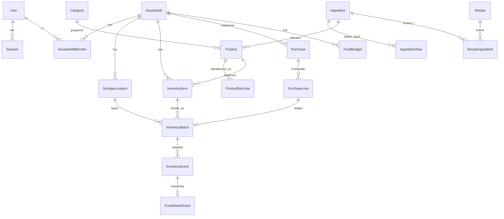

# Datamodell (utkast, fase 0)

**Status:** UTKAST. Dette er en plan for hvordan dataene henger sammen, ikke det endelige skjemaet. Tabellene opprettes
i den fasen de trengs (se kolonnen *Fase*). Skjemaet i [`prisma/schema.prisma`](../../prisma/schema.prisma) er fasiten
for tabellene som finnes.

**Implementert i fase 2 (2026-10-20):** `User`, `Household`, `HouseholdMember` og `Session`. Avvik fra planen:
`User` fikk også `failed_login_count` og `login_locked_until` (FR-AUTH-003), og `Session` fikk `csrf_token`. `currency`
er ikke lagt til ennå, fordi ingenting bruker den før fase 4. `AuditEvent` er utsatt til fase 3. Se
[kapittel 8](../academic/08-databasemodell.md).

**Implementert i fase 3 (2026-10-21):** `Category`, `StorageLocation`, `InventoryItem`, `InventoryBatch` og
`InventoryEvent`. Avvik fra planen:
- `Product` og `ProductBarcode` er utsatt til fase 7, så varen har et fritt navn (beslutning 1 i spesifikasjon 03).
- `FoodWasteEvent` er slått sammen med `InventoryEvent`. Kassering lagrer årsak og verdi i samme rad, med CHECK.
- Partiet har én dato med type (`expiry_kind` + `expiry_date`) i stedet for `best_before` og `use_by`.
- `AuditEvent` droppes; `inventory_events` er historikken (beslutning 5).

**Implementert i fase 4 (2026-10-21):** `Purchase`, `PurchaseLine` og `FoodBudget`, og `purchase_line_id` på
`InventoryBatch`. Avvik fra planen:
- `PurchaseLine` har `kind` (`food`/`nonFood`), `category_key` og `amount_ore` i stedet for `product_id`, `quantity`,
  `unit_price_ore`, `discount_ore`, `is_food` og `is_deposit`. Rabatt og pant føres som nettobeløp (avgjørelse 5 i
  spesifikasjon 04). Mengden står på partiet, ikke på linjen.
- `Budget` heter `FoodBudget` og har bare `household_id`, `valid_from` (første dag i måneden) og `amount_ore`
  (null = ikke noe budsjett). Budsjett per bruker og per kategori er utsatt (avgjørelse 8).
- Koblingen går fra parti til linje (`inventory_batches.purchase_line_id`, unik, sammensatt fremmednøkkel med
  `household_id`), ikke fra linje til parti.
- `dedupe_key` er unik per husholdning, ikke globalt.

**Implementert i fase 5 (2026-10-21):** `Ingredient`, `IngredientAlias`, `UnitConversion`, `Recipe` og
`RecipeIngredient`, og i tillegg `IngredientAllergen`, `UserAllergen` og `ingredient_id`/`ingredient_match` på
`InventoryItem`. Avvik fra planen:
- `UnitConversion` gjelder alltid én ingrediens (`ingredient_id` er påkrevd) og har to heltall (`unit_qty`, `base_qty`)
  i stedet for en `to_base_factor`. Omregning mellom g og kg, ml og dl osv. ligger i koden, ikke i tabellen.
- `IngredientAlias` har aliaset som primærnøkkel, så det er unikt på tvers av alle ingredienser. Navnet lagres også
  som alias.
- `Recipe` har `authors` (påkrevd, ADR-0009), `slug` (stabil id i frødatafilene), `steps` som liste og ikke `image`.
  `source` er `team` eller `test`.
- `RecipeIngredient` har `position` og er unik per (oppskrift, ingrediens). `quantity_base` er null for «etter smak».
- Oppskriftens allergener lagres ikke. De regnes ut fra ingrediensene (`ingredient_allergens`).
- Allergier er en egen tabell `user_allergens` knyttet til brukeren, som planen sa.
- `InventoryItem` fikk `ingredient_match` (`auto`/`manual`/`none`) og `ingredient_id` (bare ved `manual`, CHECK).

Prinsipper: [ADR-0006](architecture-decisions/0006-penger-og-mengder-som-heltall.md) (heltall for penger/mengder),
[ADR-0007](architecture-decisions/0007-kjop-som-eneste-utgiftskilde.md) (kjøp som eneste utgiftskilde),
[ADR-0008](architecture-decisions/0008-husholdning-fra-start.md) (husholdning på alle data).

## Kjernemodell (fase 2–5)

## Entiteter

| Entitet | Viktige felt | Merknad | Fase |
|---|---|---|---|
| `User` | email (unik), password_hash, display_name, locale, currency, created_at | Allergier/kosthold i egen tabell når de trengs | 2 |
| `Session` | token_hash, user_id, expires_at, last_seen_at | Bare hash av token lagres | 2 |
| `Household` | name | Én opprettes automatisk ved registrering | 2 |
| `HouseholdMember` | household_id, user_id, role (`owner`/`member`) | Unik (household_id, user_id) | 2 |
| `AuditEvent` | actor_id, action, target, created_at | Ingen personopplysninger i fritekst | 3 (utsatt fra 2) |
| `Category` | name, parent_id | Global, frødata | 3 |
| `Product` | name, brand, category_id, package_size_base, unit_kind, ingredient_id? | **Katalog** – hva varen er. Globalt eller husholdningsspesifikt (household_id nullable) | 3 |
| `ProductBarcode` | gtin (unik), product_id, source | Én vare kan ha flere strekkoder | 3 (brukes 7) |
| `StorageLocation` | household_id, name, kind (`fridge`/`freezer`/`pantry`/`other`) | Standardsteder opprettes for nye husholdninger | 3 |
| `InventoryItem` | household_id, product_id? , custom_name? | **Lager** – at husholdningen har varen | 3 |
| `InventoryBatch` | item_id, location_id, quantity_base, best_before?, use_by?, purchased_at?, price_ore?, price_basis, purchase_line_id?, source | Én fysisk pakke/parti. Ulike datoer per parti. CHECK quantity_base ≥ 0 | 3 |
| `InventoryEvent` | batch_id, type (`add`/`consume`/`discard`/`move`/`adjust`/`undo`), delta_base, actor_id, created_at | Kun innsetting – gir historikk og angre | 3 |
| `FoodWasteEvent` | event_id, reason, value_ore?, value_basis (`actual`/`estimated`/`unknown`) | Grunnlag for svinnstatistikk | 3 |
| `Purchase` | household_id, store_name?, purchased_on, total_ore, currency, source (`manual`/`receipt`/`barcode`), dedupe_key (unik per husholdning), created_by | **Eneste utgiftskilde** | 4 |
| `PurchaseLine` | household_id, purchase_id, position, description, kind (`food`/`nonFood`), category_key?, amount_ore | Ikke-mat registreres, men teller ikke i matbudsjettet og gir ikke lagerparti | 4 |
| `FoodBudget` | household_id, valid_from, amount_ore? | Gjelder fra en måned og fremover | 4 |
| `Ingredient` / `IngredientAlias` | key, name, base_unit, is_staple, category_key? / alias (unik) | Normalisering: "lettmelk", "melk 1%" → melk | 5 |
| `UnitConversion` | ingredient_id?, from_unit, to_base_factor | f.eks. 1 dl melk = 100 ml, 1 egg ≈ 60 g | 5 |
| `Recipe` | title, description, servings, prep_min, cook_min, instructions, tags, source, license, image? | Frødata fra teamet | 5 |
| `RecipeIngredient` | recipe_id, ingredient_id, quantity_base, display_text, optional | | 5 |
| `ShoppingList` / `ShoppingListItem` | household_id / list_id, text, product_id?, ingredient_id?, quantity?, checked, source_recipe_id? | | 6 |

## Senere

`Receipt` og `ReceiptExtraction` (fase 8: originalbilde med slettefrist, råtekst, tolkede linjer, konfidens, status),
`MealPlanEntry` (9), `Invitation` (10), `Notification` / `NotificationPreference` (11),
`PriceObservation` (12: product_id, chain, price_ore, unit_price, observed_at, source).

## Åpne spørsmål

- Skal `Product` kunne opprettes fritt av brukere, eller skal fritekst ligge på `InventoryItem` til produktet er kjent? (Forslag: det siste, avklares i fase 3.)
- ~~Omregning stykk ↔ gram for oppskriftsmatching: per ingrediens eller per produkt?~~ **Avklart i fase 5:** per
  ingrediens (`unit_conversions`), fordi `Product` ikke finnes før fase 7. Tallene er anslag og må kontrolleres av
  teamet.
