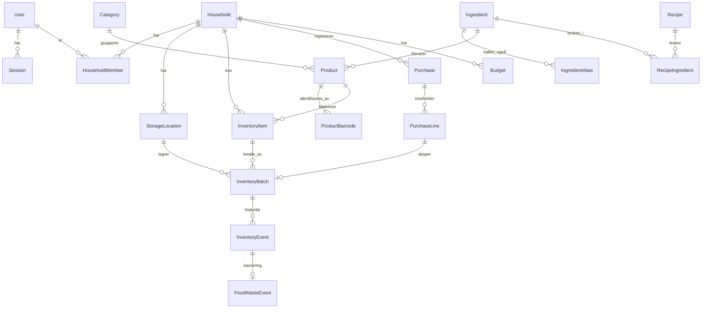

# Datamodell (utkast, fase 0)

**Status:** UTKAST. Dette er en plan for hvordan dataene henger sammen, ikke det endelige skjemaet. Tabellene opprettes
i den fasen de trengs (se kolonnen *Fase*), og skjemaet i `prisma/schema.prisma` blir fasiten når det finnes.

Prinsipper: [ADR-0006](architecture-decisions/0006-penger-og-mengder-som-heltall.md) (heltall for penger/mengder),
[ADR-0007](architecture-decisions/0007-kjop-som-eneste-utgiftskilde.md) (kjøp som eneste utgiftskilde),
[ADR-0008](architecture-decisions/0008-husholdning-fra-start.md) (husholdning på alle data).

## Kjernemodell (fase 2–5)

## Entiteter

| Entitet | Viktige felt | Merknad | Fase |
|---|---|---|---|
| `User` | email (unik), password_hash, display_name, locale, currency, created_at | Allergier/kosthold i egen tabell når de trengs | 2 |
| `Session` | token_hash, user_id, expires_at, last_seen_at | Bare hash av token lagres | 2 |
| `Household` | name | Én opprettes automatisk ved registrering | 2 |
| `HouseholdMember` | household_id, user_id, role (`owner`/`member`) | Unik (household_id, user_id) | 2 |
| `AuditEvent` | actor_id, action, target, created_at | Ingen personopplysninger i fritekst | 2 |
| `Category` | name, parent_id | Global, frødata | 3 |
| `Product` | name, brand, category_id, package_size_base, unit_kind, ingredient_id? | **Katalog** – hva varen er. Globalt eller husholdningsspesifikt (household_id nullable) | 3 |
| `ProductBarcode` | gtin (unik), product_id, source | Én vare kan ha flere strekkoder | 3 (brukes 7) |
| `StorageLocation` | household_id, name, kind (`fridge`/`freezer`/`pantry`/`other`) | Standardsteder opprettes for nye husholdninger | 3 |
| `InventoryItem` | household_id, product_id? , custom_name? | **Lager** – at husholdningen har varen | 3 |
| `InventoryBatch` | item_id, location_id, quantity_base, best_before?, use_by?, purchased_at?, price_ore?, price_basis, purchase_line_id?, source | Én fysisk pakke/parti. Ulike datoer per parti. CHECK quantity_base ≥ 0 | 3 |
| `InventoryEvent` | batch_id, type (`add`/`consume`/`discard`/`move`/`adjust`/`undo`), delta_base, actor_id, created_at | Kun innsetting – gir historikk og angre | 3 |
| `FoodWasteEvent` | event_id, reason, value_ore?, value_basis (`actual`/`estimated`/`unknown`) | Grunnlag for svinnstatistikk | 3 |
| `Purchase` | household_id, store_name?, purchased_at, total_ore, source (`manual`/`receipt`/`barcode`), dedupe_key (unik), created_by | **Eneste utgiftskilde** | 4 |
| `PurchaseLine` | purchase_id, description, product_id?, quantity, unit_price_ore, discount_ore, line_total_ore, is_food, is_deposit | Ikke-mat teller som utgift men gir ikke lagerparti | 4 |
| `Budget` | household_id eller user_id, period_start, period_end, amount_ore, category_id? | Én av household_id/user_id (CHECK) | 4 |
| `Ingredient` / `IngredientAlias` | canonical_name / alias | Normalisering: "lettmelk", "melk 1%" → melk | 5 |
| `UnitConversion` | ingredient_id?, from_unit, to_base_factor | f.eks. 1 dl melk = 100 ml, 1 egg ≈ 60 g | 5 |
| `Recipe` | title, description, servings, prep_min, cook_min, instructions, tags, source, license, image? | Frødata fra teamet | 5 |
| `RecipeIngredient` | recipe_id, ingredient_id, quantity_base, display_text, optional | | 5 |
| `ShoppingList` / `ShoppingListItem` | household_id / list_id, text, product_id?, ingredient_id?, quantity?, checked, source_recipe_id? | | 6 |

## Senere

`Receipt` og `ReceiptExtraction` (fase 8: originalbilde med slettefrist, råtekst, tolkede linjer, konfidens, status),
`MealPlanEntry` (9), `Invitation` (10), `Notification` / `NotificationPreference` (11),
`PriceObservation` (12: product_id, chain, price_ore, unit_price, observed_at, source).

## Åpne spørsmål

- Skal `Product` kunne opprettes fritt av brukere, eller skal fritekst ligge på `InventoryItem` til produktet er kjent? (Forslag: det siste, avklares i fase 3.)
- Omregning stykk ↔ gram for oppskriftsmatching: per ingrediens eller per produkt? (Avklares i fase 5.)
